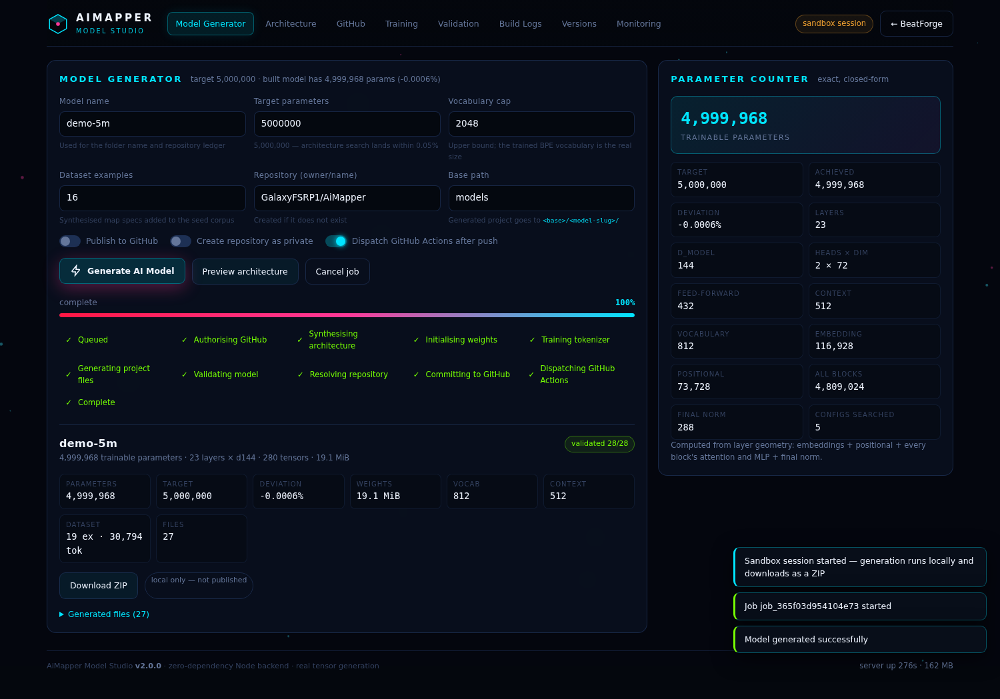
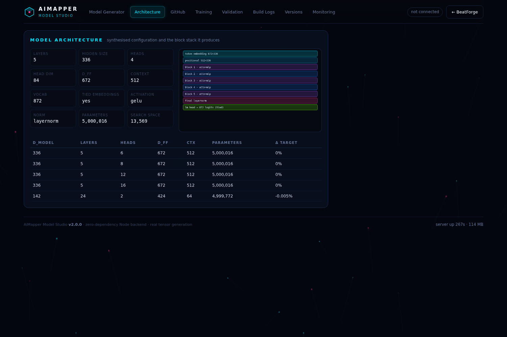
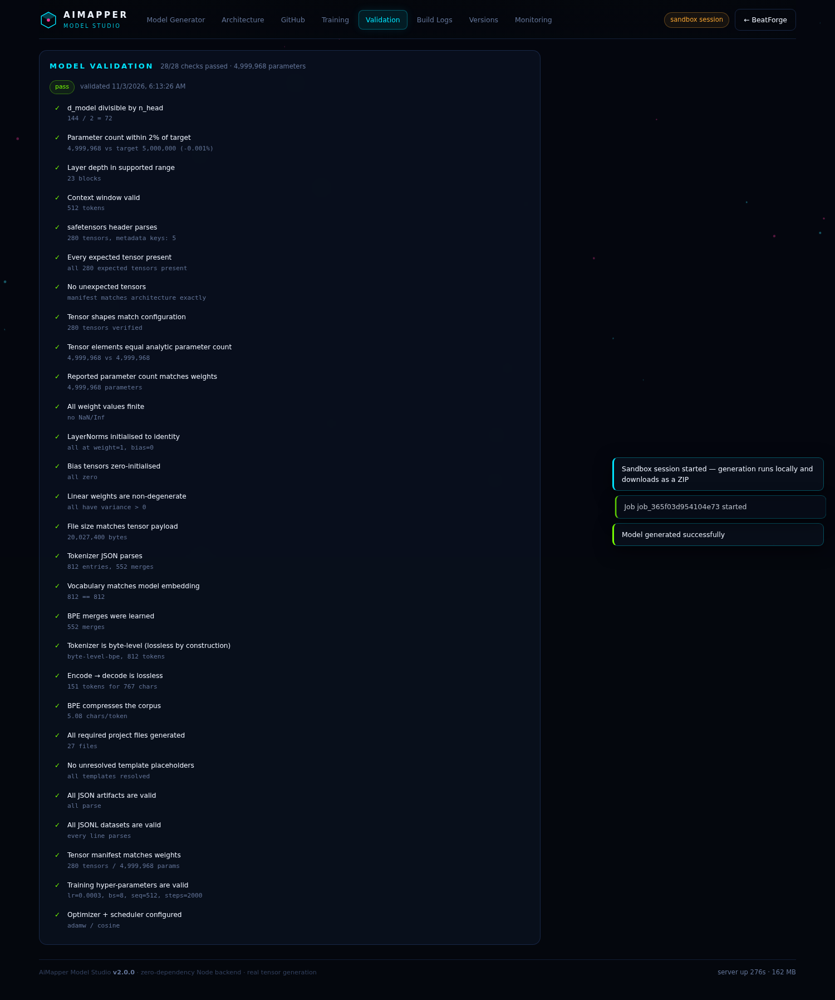
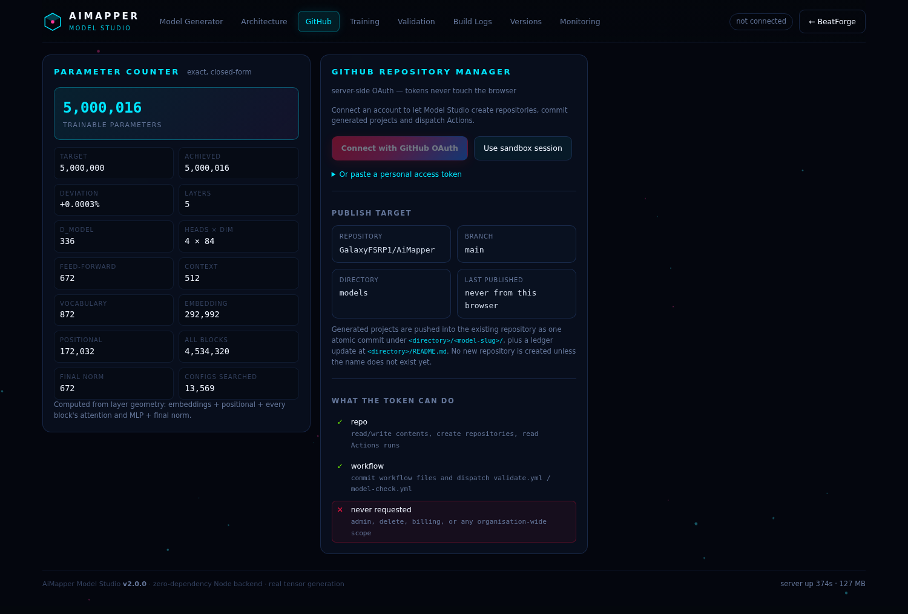
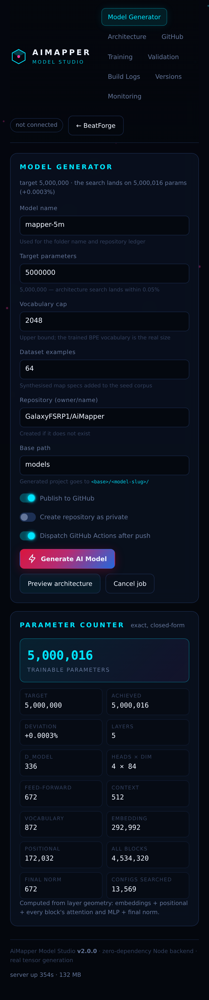

# AiMapper

Two applications in one website:

| | What it is | Where |
|---|---|---|
| **BeatForge** | AI Beat Saber auto-mapper — spectral analysis, BPM detection, BSMG-compliant pattern generation, ArcViewer preview | `/` (`index.html`) |
| **Model Studio** | Automated ~5,000,000-parameter AI model generator that builds a complete, real model project and publishes it to GitHub | `/studio` (`app/web/model-studio.html`) |

Everything runs in the browser against this server. Nothing is installed on your machine, and the only thing that leaves the server is the generated project, committed to your GitHub repository.



| | |
|---|---|
|  |  |
|  |  |

---

## Model Studio — what it actually does

Clicking **Generate AI Model** runs this pipeline for real:

1. **Train the tokenizer.** A byte-level BPE vocabulary is learned from the map corpus (seeds + synthesised map specs in the `mapper-gpt/1` format). The learned vocabulary sizes the model.
2. **Synthesise the architecture.** A closed-form parameter counter enumerates decoder-transformer configurations and picks the one that lands closest to your target. For 5,000,000 parameters at a ~870-token vocabulary it lands on ~5,000,016 (deviation < 0.01%). The dashboard's preview trains the same tokenizer first, so the predicted width/depth are the ones the build actually uses — and after a run the counter rebinds to the model that really exists on disk.
3. **Initialise the weights.** Every tensor is generated with seeded Kaiming-normal / normal(0, 0.02) initialisation and written to a real `safetensors` file (~19 MiB, ~90 tensors). Same seed ⇒ identical bytes.
4. **Generate the project.** Source, config, tokenizer, datasets, docs, architecture diagram, tests and three GitHub Actions workflows.
5. **Validate.** 25+ checks re-parse the generated bytes: safetensors header, tensor shapes, element count vs. analytic count, finite values, LayerNorm/bias init, tokenizer round-trip, JSON/JSONL validity, template completeness.
6. **Publish.** One atomic Git commit (blob → tree → commit → ref) into your repository, plus a `models/README.md` ledger. The repository is created if it does not exist.
7. **Dispatch CI.** `validate.yml` and `model-check.yml` are triggered; the run URL comes back to the dashboard.

The model itself is a real GPT-style decoder: pre-LayerNorm blocks, causal multi-head self-attention, GELU MLP, tied input/output embeddings, learned absolute positions — and the generated `model.py` loads the committed checkpoint with `load_state_dict(..., strict=True)`.

### Generated project layout

```
models/<model-slug>/
├── config.json                  # architecture + training configuration
├── generation_config.json       # sampling defaults
├── model.py                     # PyTorch model (loads the committed weights)
├── train.py                     # real training loop (AdamW, cosine, clipping)
├── inference.py                 # generation script
├── benchmark.py                 # parameter count + latency
├── validate.py                  # standalone validator (same checks as CI)
├── requirements.txt
├── weights/model.safetensors    # real initialised float32 tensors
├── weights/tensor_manifest.json # per-tensor shapes, init methods, sha256
├── tokenizer/vocab.json         # trained byte-level BPE
├── tokenizer/tokenizer.py       # encoder/decoder (lossless)
├── tokenizer/train_tokenizer.py # reproduces the vocabulary
├── data/prepare_data.py         # corpus builder
├── data/seeds.jsonl
├── data/corpus/{train,val}.jsonl
├── docs/{architecture.png,architecture.md}
└── .github/workflows/{validate,model-check,publish}.yml
```

---

## Running it

Requires **Node.js 18+**. There are no npm dependencies — nothing to install.

```bash
node app/backend/server.js
# BeatForge        -> http://localhost:8080
# Model Studio     -> http://localhost:8080/studio
```

Or deploy to any free Node host (Render, Railway, Fly, Vercel via a Node runtime, a VPS…). It listens on `PORT` (default 8080) and binds `0.0.0.0`.

### Environment variables

| Variable | Required | Purpose |
|---|---|---|
| `PORT` | no | default `8080` |
| `GITHUB_CLIENT_ID` | for OAuth | OAuth App client id |
| `GITHUB_CLIENT_SECRET` | for OAuth | OAuth App client secret (server only) |
| `GITHUB_REDIRECT_URI` | no | override the callback URL |
| `MAPPER_DATA_DIR` | no | where sessions/jobs are stored (default `.data/`) |
| `MAPPER_ENCRYPTION_KEY` | no | 32-byte hex key for the credential vault; auto-generated otherwise |
| `MAPPER_DEFAULT_OWNER` | no | default owner in the form (`GalaxyFSRP1`) |
| `MAPPER_DEFAULT_REPO` | no | default repository (`AiMapper`) |
| `MAPPER_DEFAULT_BASE_PATH` | no | default folder prefix (`models`) |
| `MAPPER_DISABLE_MANUAL_TOKEN` | no | set `1` to force OAuth only |
| `MAPPER_DISABLE_SANDBOX` | no | set `1` to disallow local-only sandbox sessions |
| `MAPPER_ALLOW_ANY_ORIGIN` | no | set `1` to relax same-origin checks (preview proxies) |
| `MAPPER_ALLOWED_ORIGINS` | no | comma-separated extra allowed origins |
| `MAPPER_TRUST_PROXY` | no | set `1` behind a reverse proxy (uses `X-Forwarded-*`) |

### Connecting GitHub

**OAuth (recommended).** Create an OAuth App at <https://github.com/settings/developers>:

- Homepage: `https://your-deployment`
- Callback: `https://your-deployment/auth/github/callback`

Set `GITHUB_CLIENT_ID` and `GITHUB_CLIENT_SECRET`, restart, then use **Connect with GitHub OAuth**. The app requests the `repo` and `workflow` scopes. Access tokens are stored sealed with AES-256-GCM and refreshed automatically when GitHub issues expiring tokens.

**Token (fallback).** Paste a fine-grained token with *Contents: read/write* and *Workflows: read/write* (or a classic token with `repo` + `workflow`). It is sealed the same way and never returned to the browser.

**Sandbox session.** Lets you generate a model with no GitHub account at all: the job stays local and you download the finished project as a ZIP. Useful for trying the generator.

### Security model

- The OAuth client secret and every user token exist only server-side, sealed with AES-256-GCM bound to the owning session (AAD).
- No API response contains a token; `/api/status` returns booleans plus a login name.
- Session cookies are `HttpOnly`, `SameSite=Lax`, and `Secure` over TLS.
- State-changing requests are POST-only and same-origin checked; OAuth uses a signed `state` value plus PKCE.
- Rate limits on auth, session and generation endpoints; per-job ownership checks return 403 across sessions.
- Static serving is an allowlist — the data directory, backend source and tests are never web-accessible.

---

## Tests

```bash
node tests/pipeline.test.js    # generation, validation, zip integrity, real weight statistics
node tests/api.test.js         # HTTP API, background job lifecycle, artifact download, security probes
node tests/github.test.js      # full publishing path against a mock GitHub API
node tests/ui.test.js          # boots the real studio.js against the real server and drives the UI
node tests/publish-ui.test.js  # connect → verify repo → generate → publish, through the browser
node tests/train.test.js       # trains the generated model (needs python3 + torch)
npm run verify                 # every suite above + the deliverable zip
```

Current status: **pipeline 17, API 31, GitHub 20, UI 41, publish-UI 28 — all passing**, plus a real
12-step training run of a generated model.

`tests/github.test.js --live OWNER/REPO` (or `npm run test:live`) runs the same publishing path
against the real GitHub API using `GITHUB_TOKEN`. That is the one thing that cannot be proven from
this workspace, because it needs repository credentials.

CI (`.github/workflows/validate.yml`) runs all five suites on every push, rebuilds a reference
5M-parameter model, installs PyTorch and does a strict `load_state_dict` + forward pass + 12
training steps on it, and syntax-checks the front-end.

---

---

## Deploying

The server is a single Node process with zero dependencies, so it runs anywhere Node 18+ runs.

| Target | How |
|---|---|
| **Render** | Push the repo, create a Blueprint from `render.yaml`, then set `GITHUB_CLIENT_ID` / `GITHUB_CLIENT_SECRET` in the dashboard. A 1 GB disk at `/var/data` keeps sessions across deploys. |
| **Docker** | `npm run docker:build`, then `docker run --rm -p 8080:8080 -e GITHUB_CLIENT_ID=… -e GITHUB_CLIENT_SECRET=… aimapper` |
| **Any VPS** | `node app/backend/server.js` behind nginx/Caddy, with `MAPPER_TRUST_PROXY=1` |
| **Fly/Railway/Cloud Run** | Use the `Dockerfile`; set `MAPPER_DATA_DIR` to a mounted volume |

For the GitHub OAuth app, set the callback URL to `https://<your-domain>/auth/github/callback`.
Without OAuth credentials the app still works: the **Use sandbox session** button generates real
models and downloads them as a ZIP, and a personal access token can be pasted instead.

`.env.example` lists every variable.

---

## Architecture of this repo

```
index.html, style.css, app.js, ai_model.js   BeatForge (unchanged behaviour)
app/web/model-studio.html, studio.js, studio.css   Model Studio dashboard
app/backend/
  server.js           HTTP server, routes, static allowlist
  jobs.js             background job runner, progress, publishing
  store.js            JSON persistence (sessions, jobs, history, logs)
  logger.js           structured logs + in-memory ring buffer
  lib/
    model-spec.js     architecture search, exact parameter counting, weights, safetensors
    corpus.js         corpus synthesis + byte-level BPE (train + encode)
    project-builder.js  assembles every generated file
    validator.js      post-generation validation on the real bytes
    github.js         OAuth + PKCE, token refresh, REST client with retry
    zip.js, png.js    dependency-free ZIP writer and PNG encoder
    vault.js          AES-256-GCM sealing for credentials
  templates/python/   generated model/training/tokenizer sources
  templates/github/   generated GitHub Actions workflows
```

Zero runtime dependencies. `node:zlib` and `node:crypto` do the heavy lifting.

---

## Preserved BeatForge functionality

The original mapper is untouched: upload/drag-drop audio and cover, ID3 + filename metadata parsing, five-method BPM detection with variable-BPM regions, section detection, BSMG pattern engine with parity/comfort validation, per-difficulty downmapping, lighting/arcs/chains/walls/bombs, ranked scoring, ArcViewer preview, BeatSaver browser, and ZIP export. The only change is a **MODEL STUDIO** badge in the header linking to `/studio`.

## Getting the source onto GitHub

See **[PUSH-TO-GITHUB.md](PUSH-TO-GITHUB.md)** — four git commands, plus how to prove the publish
path against the real API and how to set up OAuth.

## License

MIT
